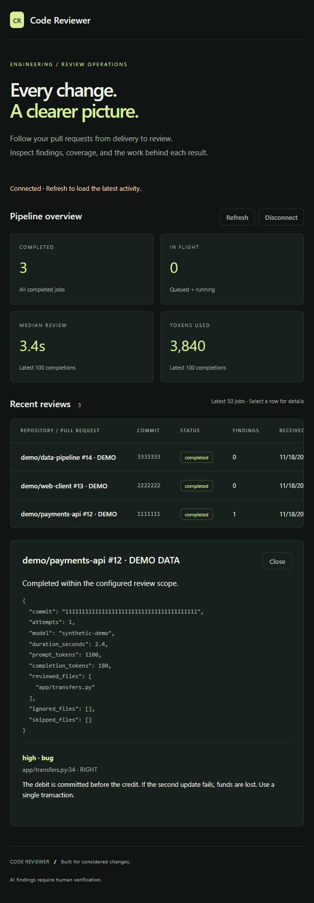
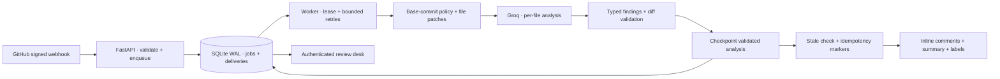

# AI Code Reviewer · Review desk

A GitHub pull-request reviewer built with FastAPI, Groq and a durable SQLite job
queue. It validates model findings against real diff locations, publishes
commit-linked comments, and makes review coverage and failures visible.



## What it does

- Verifies signed GitHub webhooks, persists jobs and returns HTTP 202 promptly.
- Deduplicates webhook deliveries and commits; workers use exclusive renewable
  leases, crash recovery and bounded transient-error retries.
- Supports GitHub App installation tokens or personal-token local demos.
- Loads repository review policy from the PR's base commit.
- Reviews whole file patches within configured budgets; reports skipped files
  and partial coverage instead of silently truncating large diffs.
- Validates strict finding types, severity, category, path, line and diff side.
- Checks for stale commits and checkpoints findings before publication.
- Adds bot-owned inline comments, updates one summary, and manages neutral
  `ai:findings`, `ai:clear`, or `ai:partial` labels.
- Provides an authenticated dashboard, job APIs, token/latency metrics and
  audited manual retries for failed jobs.
- Includes 30 labeled evaluation cases, a recorded live benchmark, Docker
  configuration and GitHub Actions quality gates.

AI feedback is advisory. A clear result means no qualifying findings within the
reported scope; it is not human approval or proof that code is safe.

## Architecture



The API and worker run separately on **one host with shared local storage**.
See [architecture and tradeoffs](docs/ARCHITECTURE.md) before scaling.

## Run locally

Use Python 3.13. PowerShell:

```powershell
python -m venv .venv
.\.venv\Scripts\Activate.ps1
python -m pip install -r requirements-dev.txt
Copy-Item .env.example .env
```

Fill `.env` using [GitHub App setup](docs/GITHUB_APP.md) or a fine-grained personal
token. Required settings are `GITHUB_WEBHOOK_SECRET`, `GROQ_API_KEY`,
`DASHBOARD_TOKEN`, and GitHub credentials. Generate local secrets with
`python -c "import secrets; print(secrets.token_urlsafe(32))"`.

Run these in separate terminals with the same environment/database path:

```sh
python -m uvicorn app.main:app --host 127.0.0.1 --port 8000
python -m app.worker
```

Open [Review desk](http://127.0.0.1:8000/dashboard) and enter your dashboard token.
The API schema is at `/docs`; `/health` checks process liveness. For GitHub
deliveries, expose `/webhook` through HTTPS and subscribe to pull-request events.
Never expose private keys or `.env` through the web server.

For an offline UI demonstration, use the separate, clearly labeled
[synthetic demo database](docs/DASHBOARD.md). For containers, see
[Docker and deployment instructions](docs/DEPLOYMENT.md).

## Repository policy

Merge `.ai-reviewer.json` into the base branch to configure ignored paths,
severity/categories and file/character budgets. Proposed PR changes cannot
modify their own effective review policy. See [policy semantics](docs/REVIEW_POLICY.md).

## Verify

```sh
python -m ruff check app tests evaluation scripts
python -m ruff format --check app tests evaluation scripts
python -m pytest tests --cov=app --cov-report=term-missing
python -m evaluation.run --output reports/dry-run.json
```

Tests use temporary databases, mocked Groq results and an HTTP mock transport.
They exercise the signed-webhook → queue → worker → validated GitHub publication
flow, failures, retry checkpoints, leases, auth and review scope. CI enforces
80% coverage and also builds/smoke-tests the container; it performs no live API
calls. See [operations](docs/OPERATIONS.md) for job recovery and backups.

The [verification snapshot](docs/VERIFICATION.md) records 41 passing tests and
86.28% coverage, plus checks that still require a Docker-enabled host and valid
GitHub credentials. It distinguishes configured CI from an actual hosted run.

## Evaluation evidence

The [recorded live report](evaluation/results/groq-bugs-v2.json) covers 30 synthetic
Python/JavaScript scenarios using `openai/gpt-oss-120b` and prompt `bugs-v2`:

| Measurement | Recorded result |
| --- | ---: |
| Completed cases | 30 / 30 |
| Location/category precision | 55.2% |
| Location/category recall | 80.0% |
| Invalid comment locations | 0 |
| Median case latency, including retries | 1.85 s |
| Prompt / completion tokens | 7,722 / 8,064 |

These are location/category matching proxies on a small synthetic dataset.
They are **not** human-adjudicated defect precision or production performance.
The raw findings expose false positives, repeated root causes and classification
errors. See [evaluation methodology](docs/EVALUATION.md) before quoting results.

Run a new live benchmark explicitly (uses your Groq API credits):

```sh
python -m evaluation.run --live --output reports/my-run.json
```

## Current limits

- SQLite coordination supports one host/local volume, not independent replicas.
- Model analysis has only diff context and can miss defects or invent findings.
- Binary, oversized and missing patches are reported as unreviewed.
- Publishing across GitHub and SQLite is best-effort idempotent, not exactly once.
- Dashboard authentication is for a single operator; no per-user tenant roles.
- Docker files and CI are provided; a public deployment and live GitHub App
  installation are not provisioned by the repository itself.

For a project presentation, see the [demo walkthrough](docs/DEMO.md),
[resume bullets and interview notes](docs/RESUME.md), and
[assigned commit-date disclosure](docs/BUILD_HISTORY.md).

## License

[MIT](LICENSE)
