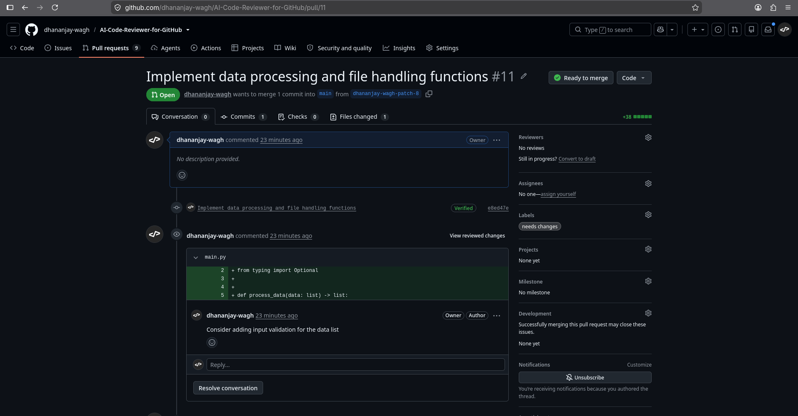

# AI Code Reviewer for GitHub

A FastAPI-based GitHub webhook service that reviews pull request diffs using Groq, posts inline review comments, and adds labels back to GitHub.



## Features

- Receives GitHub pull request webhook events
- Verifies webhook signatures
- Fetches PR diffs from GitHub
- Sends diffs to Groq for AI review
- Posts inline comments on changed code
- Adds labels like `needs changes` or `approved`
- Supports opened, reopened, and updated pull requests
- Includes basic tests for webhook signature verification

## Tech Stack

- FastAPI + uvicorn
- Groq API (llama-3.3-70b-versatile)
- GitHub REST API
- httpx
- Railway (deployment)

## How it Works

1. GitHub sends a pull request webhook.
2. The app verifies the webhook signature.
3. The app fetches the pull request diff.
4. The diff is sent to Groq for review.
5. AI-generated comments are posted back to the PR.
6. The PR is labeled based on review results


## Environment Variables

Create a `.env` file:

```env
GITHUB_WEBHOOK_SECRET= 
GITHUB_TOKEN= 
GROQ_API_KEY=
```

## Setup

1. Clone the repo
2. Install dependencies: `pip install -r requirements.txt`
3. Copy `.env.example` to `.env` and fill in your keys
4. Run: `uvicorn app.main:app --reload`
5. Set up ngrok and configure GitHub webhook
6. Set your webhook secret in `.env` to match what you set on GitHub

## Running Tests

```bash
pytest tests/
```

## Current Limitations

- Basic error handling
- AI response validation is still limited
- Large diffs are truncated before review
- No duplicate-comment prevention yet
- GitHub API failures are logged but not surfaced with detailed responses

## Planned Improvements

- Add stronger error handling
- Improve AI review output validation
- Add Docker support
- Add summary review comments
- Add duplicate-comment prevention
- Split utility logic into smaller modules
